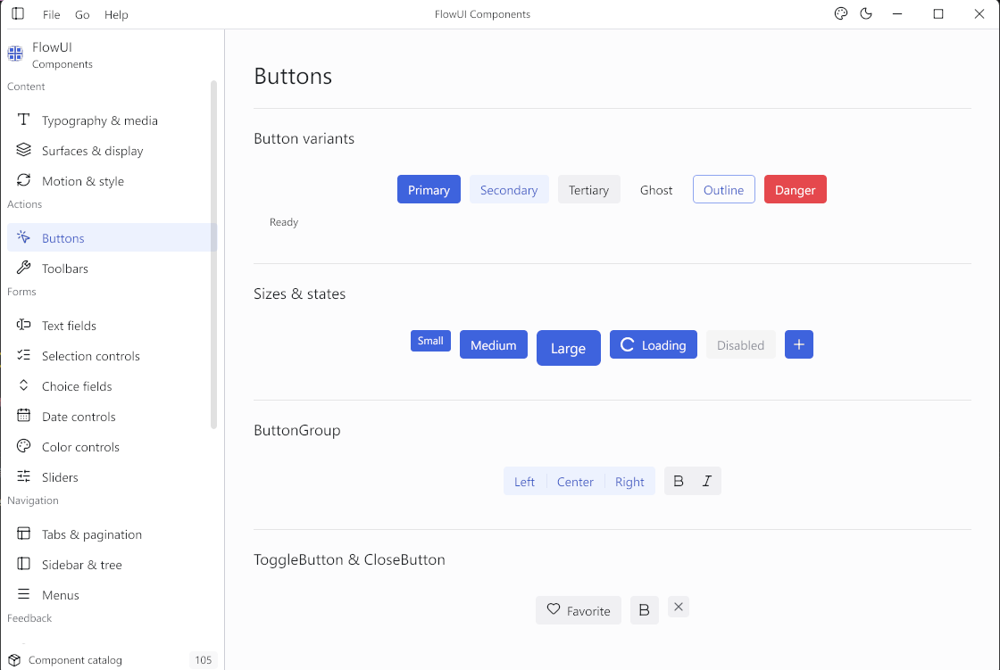

# FlowUI

[English](README.md)

[English documentation](https://qianniancn.github.io/flowui/en/) · [中文文档](https://qianniancn.github.io/flowui/)

[](https://pkg.go.dev/github.com/qianniancn/flowui/ui)
[](go.mod)
[](LICENSE)

FlowUI 是一个基于 [Gio](https://gioui.org/) 构建的 Go 桌面 UI 框架。
它通过职责清晰的公开包，提供类型化 MVU 运行时、官方组件、布局原语、声明式样式、
窗口管理、异步副作用以及可重复的 UI 测试能力。

```go
import (
	"github.com/qianniancn/flowui/layout"
	"github.com/qianniancn/flowui/style"
	"github.com/qianniancn/flowui/theme/base"
	"github.com/qianniancn/flowui/ui"
	"github.com/qianniancn/flowui/widget/button"
	"github.com/qianniancn/flowui/window"
)
```



## 核心能力

- **类型化 MVU：** 业务状态放在 Model 中，用消息描述变化，View 只负责读取和渲染。
- **桌面组件：** 覆盖表单、导航、浮层、数据展示、图表、窗口外壳和布局原语。
- **声明式样式：** 支持主题令牌、明暗主题、组件部件、运行时状态、过渡和作用域样式。
- **应用运行时：** 支持 Command、订阅、多窗口、Model 保留和本地化。
- **平台服务：** 可选包提供原生文件对话框、桌面通知和系统托盘集成。
- **易于测试：** `uitest` 提供确定性的帧、输入、时间和应用测试工具。

## 环境要求

- Go 1.26.2 或更高版本
- Gio 支持的桌面平台

## 安装

```bash
go get github.com/qianniancn/flowui/ui
```

## 快速开始

在一个 Go module 中创建 `main.go`：

```go
package main

import (
	"fmt"

	"github.com/qianniancn/flowui/layout"
	"github.com/qianniancn/flowui/theme/base"
	"github.com/qianniancn/flowui/ui"
	"github.com/qianniancn/flowui/widget/button"
	"github.com/qianniancn/flowui/widget/text"
	"github.com/qianniancn/flowui/window"
)

type Model struct {
	Count int
}

type Msg interface{ msg() }

type Inc struct{}
type Dec struct{}

func (Inc) msg() {}
func (Dec) msg() {}

func Update(model *Model, msg Msg) ui.Cmd[Msg] {
	switch msg.(type) {
	case Inc:
		model.Count++
	case Dec:
		model.Count--
	}
	return nil
}

func View(_ *ui.Context, model Model, send ui.Send[Msg]) ui.Widget {
	return layout.Center(
		layout.Column(
			text.New("FlowUI Counter").Size(24),
			text.New(fmt.Sprintf("Count: %d", model.Count)),
			layout.Row(
				button.New("-1").OnClick(func() {
					send(Dec{})
				}),
				button.New("+1").OnClick(func() {
					send(Inc{})
				}),
			).Gap(8),
		).Gap(12),
	)
}

func main() {
	ui.Run(ui.NewProgram(Model{}, Update, View),
		window.Theme(base.Light()),
		window.Title("FlowUI Counter"),
		window.Size(640, 480),
	)
}
```

运行：

```bash
go run .
```

需要分步讲解时，请阅读[快速开始](https://qianniancn.github.io/flowui/guide/01-快速开始/)。

## 核心模型

FlowUI 遵循三条状态与布局归属规则：

1. **Model、消息和 Update 管理业务状态。** View 读取 Model 的值并发送类型化消息，
   不直接修改捕获的状态。
2. **Style 管理组件自身的盒子和外观。** 布局容器负责测量和排列子项。
3. **Key 提供跨帧身份。** 稳定的 Key 会为重复或移动的组件保留交互与动画状态。

根据应用需要的生命周期选择 API：

| API | 适用场景 |
| --- | --- |
| `ui.Run(ui.Program)` | 所有单窗口 MVU 应用的启动入口 |
| `ui.NewProgram` | 为固定初始 Model 快速构造 Program |
| `ui.Application` | 多窗口、托盘和由应用管理的生命周期 |

Command 在事件循环外执行，并通过 `ui.Send` 返回结果。订阅用于计时器、外部事件流等
长期输入。完整契约见 [MVU 与消息](https://qianniancn.github.io/flowui/guide/03-MVU与消息/)
和[命令与订阅](https://qianniancn.github.io/flowui/guide/08-命令与订阅/)。

## 组件

| 分类 | 包含的 API |
| --- | --- |
| 内容 | `text.New`、`label.New`、`description.New`、`image.New`、`avatar.New`、`badge.New`、`chip.New` |
| 操作 | `button.New`、`button.Group`、`togglebutton.New`、`closebutton.New` |
| 表单 | `input.New`、`input.NewTextArea`、`checkbox.New`、`switchcontrol.New`、`radiogroup.New`、`selectfield.New`、`combobox.New`、日期和颜色选择器 |
| 导航 | `tabs.New`、`sidebar.New`、`tree.New`、`menu.New`、`menubar.New`、`pagination.New`、`toolbar.New` |
| 浮层 | `dropdown.New`、`menu.ContextMenu`、`popover.New`、`tooltip.New`、`modal.New`、`alertdialog.New`、`toast.NewItem` |
| 数据与反馈 | `table.New`、`progress.Bar`、`progress.Circle`、`progress.Meter`、`spinner.New`、`slider.New`、图表、`heatmap.New`、`gantt.New` |
| 布局 | `layout.Box`、`surface.New`、`card.New`、`layout.Row`、`layout.Column`、`layout.Grid`、`layout.Scroll`、`layout.SplitPane`、`layout.Stack`、`layout.Overlay` |

可以阅读[组件一览](https://qianniancn.github.io/flowui/guide/06-组件一览/)，
了解完整的组件目录。

## 样式与主题

Style 是不可变声明，从当前主题取值并响应运行时状态。同一份声明会自动适配当前的
浅色或深色主题：

```go
activeTheme := base.Light()

primary := style.New().
	Background(style.Solid(activeTheme.Palette.Accent)).
	TextColor(style.Solid(activeTheme.Palette.AccentForeground)).
	Radius(8).
	Cursor(style.CursorPointer).
	On(style.Hovered, style.New().Background(style.Solid(activeTheme.Palette.AccentHover))).
	On(style.Pressed, style.New().Background(style.Solid(activeTheme.Palette.AccentPressed)).Scale(0.96))

save := button.New("Save").Style(primary)
```

运行时必须显式选择实现了完整 Style Provider 的主题，例如
`window.Theme(base.Light())` 或 `window.Theme(base.Dark())`；选定主题后可以用
`window.CustomizeTheme` 做局部调整。复合控件通过 `style.PartContent`、
`style.PartTrack`、`style.PartIndicator`、`style.PartPanel` 等命名部件提供精确样式入口。FlowUI 内置中英文组件
文案，`window.LanguageAuto` 会跟随系统语言。

[样式与主题](https://qianniancn.github.io/flowui/guide/05-样式与主题/)介绍了优先级、
命名部件、颜色、几何、过渡动画和字体配置。

FlowUI 默认使用系统字体回退。需要固定渲染结果时，可以用
`style.ParseFontCollection` 解析随程序打包的 TTF、OTF 或 TTC，再放入
`theme.Fonts.Collection`，并将 `theme.Fonts.SystemFonts` 设为 `false`。

核心只维护 `theme/base` 一套默认设计，支持明暗两种模式。
应用可以直接使用 `base.Light()` / `base.Dark()`，也可以基于公开的主题 API 构建外部 Provider。

## 公开包

| 包 | 职责 |
| --- | --- |
| `ui` | MVU 程序、上下文、Widget 契约和应用生命周期 |
| `widget/<component>` | 官方完整组件 |
| `layout` | 布局容器和通用盒子宿主 |
| `style` | 不可变样式声明、级联和令牌 |
| `theme/base` | 默认明暗主题与完整 Provider |
| `theme` | 主题值、视觉协议与扩展 API |
| `draw` | 底层画刷、边框、阴影、路径和变换 |
| `animation` | 可复用的补间、弹簧和时间线原语 |
| `window` | 原生窗口选项和本地化配置 |
| `uitest` | 确定性的组件和应用测试工具 |

推荐先运行[全部组件展示](examples/showcase/README.md)：`go run ./examples/showcase`。
65 个页面覆盖全部公开 widget 包，支持搜索、交互、用法代码、明暗主题和窄窗目录。

默认主题的专项示例位于当前 module：`go run ./examples/counter`、
`go run ./examples/buttons`、`go run ./examples/inputs`、`go run ./examples/style-gallery`，
以及演示原生关窗确认的 `go run ./examples/close_guard`。

## 文档

| 资源 | 用途 |
| --- | --- |
| [使用教程](https://qianniancn.github.io/flowui/) | 从第一个应用到高级功能的任务式教程 |
| [Package Reference](https://pkg.go.dev/github.com/qianniancn/flowui/ui) | 公开 Go API |
| [`docs/architecture.md`](docs/architecture.md) | 依赖方向、状态归属、浮层和副作用 |
| [`explorer/README.md`](explorer/README.md) | 每窗口原生打开和保存对话框 |
| [`notify/README.md`](notify/README.md) | 跨平台原生通知 |
| [`systray/README.md`](systray/README.md) | 跨平台托盘生命周期与原生菜单 |
| [`CONTRIBUTING.md`](CONTRIBUTING.md) | 开发流程和贡献规范 |

应用使用 `ui` 构建 MVU 和运行时，按职责组合 `widget/<component>`、`layout`、`style`、`draw`、
`window`。`explorer`、`notify`、`systray` 是可选平台服务。应用不得直接使用 `internal`
下的包。仓库根目录有意不提供 Go package。

## 测试

在仓库根目录运行完整检查：

```bash
go test ./...
go vet ./...
```

`uitest` 用于组件和应用测试，普通应用运行时不需要依赖它。详见
[测试教程](https://qianniancn.github.io/flowui/guide/13-测试/)。

## 参与贡献

欢迎参与贡献。提交修改前请阅读 [`CONTRIBUTING.md`](CONTRIBUTING.md)。

## 许可证

FlowUI 使用 [MIT License](LICENSE)。
