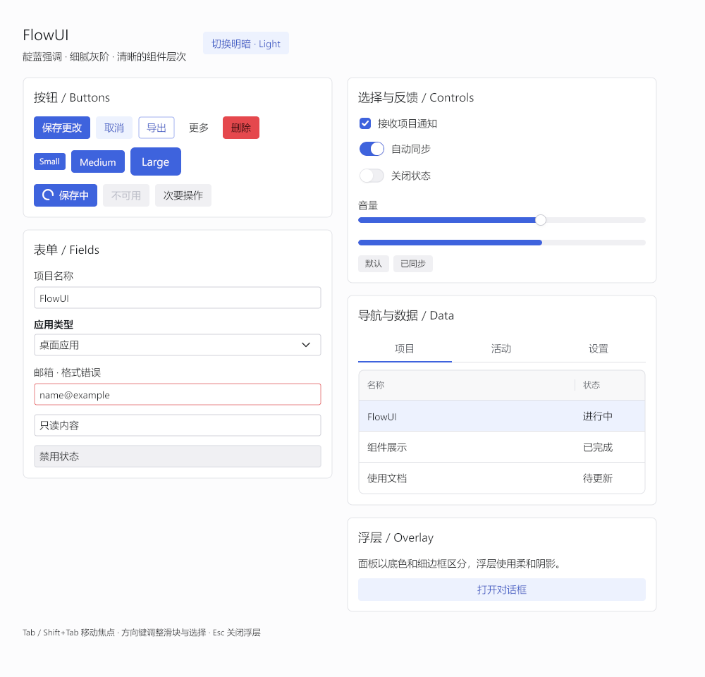

# 18 · Default theme and external styles

The FlowUI core maintains one default design system in `theme/base`, with light
and dark modes. Widgets own behavior and layout; `theme/*style` packages own
shared visual recipes. Other design systems belong to optional external modules.

## Default theme

```go
import "github.com/qianniancn/flowui/theme/base"
```

Select a complete theme explicitly when opening a window:

```go
ui.Run(ui.NewProgram(Model{}, Update, View),
    window.Theme(base.Light()), // base.Dark() for dark mode
    window.Title("FlowUI"),
    window.Size(900, 640),
)
```

Both constructors install a complete Provider. The lower-level `theme.New` and
`theme.NewDark` create values only and require a Provider before use in a window.
From application message handling, call `application.SetTheme("main", base.Dark())`
to apply a replacement through the target window's event loop. Run the default
light/dark demonstration from the core repository:

```sh
go run ./examples/style-gallery
```

## Default visual specification

The default theme uses Indigo accents, Slate greys, thin borders and soft
selections. Surface colours separate regions. Ordinary buttons, fields and cards
have no drop shadows; floating menus and dialogs retain soft shadows. The palette
is opaque and has no React or CSS dependency.

| Role | Light | Dark |
| --- | --- | --- |
| Window background | `#FCFCFD` | `#111113` |
| Card / overlay | `#FFFFFF` | `#18191B` |
| Field background | `#FFFFFF` | `#121314` |
| Body text | `#1C2024` | `#EDEEF0` |
| Accent | `#3E63DD` | `#3E63DD` |
| Field border | `#CDCED6` | `#43484E` |

Small / standard / large buttons and inputs are **24 / 32 / 40dp** tall with
**1dp** borders. Button radii are **3 / 4 / 6dp**, cards **8dp** and dialogs **12dp**.
Body text is **14sp**; gallery headings use **17 / 22sp**. Standard switches measure
**35×20dp** with an **18dp** white thumb. Sliders use an **8dp** track and a
**16dp** white round thumb. Standard table rows are **44dp** tall; underline tabs
are **40dp** tall. Selected list and table rows use a soft accent surface.
Bordered fields darken their stroke on hover; focus keeps the fill and adds a
soft accent halo behind a **1dp** stroke instead of thickening it. Select and
ComboBox option panels and the DatePicker calendar use a **1dp** border and the
menu shadow profile so they read as a layer above the form.

On Windows, the default typeface list is `Segoe UI, Microsoft YaHei UI, sans-serif`.
These UI families provide compatible Latin and Chinese line metrics, avoiding
generic fallback faces whose excessive line gap leaves control labels visibly high.




Overlay previews: [light dialog](../assets/default-theme-light-dialog.png)
and [dark dialog](../assets/default-theme-dark-dialog.png). These images are
actual gallery renders from Windows. Regenerate them from the repository root
in PowerShell:

```powershell
$env:FLOWUI_UPDATE_SCREENSHOTS = '1'
go test ./examples/style-gallery -run TestView -count=1
Remove-Item Env:FLOWUI_UPDATE_SCREENSHOTS
```

## Custom colours and geometry

Derive a theme from a seed to update the accent and its associated semantic and
interaction colours together:

```go
seed := theme.DefaultSeed()
seed.Primary = color.NRGBA{R: 0x10, G: 0xb9, B: 0x81, A: 0xff}
active := base.New(seed) // base.NewDark(seed) for dark mode
active.Components.Input.Radius = 8
```

Import `theme` from `github.com/qianniancn/flowui/theme`, `base` from
`github.com/qianniancn/flowui/theme/base`, and `color` from `image/color`.
Pass the result to `window.Theme(active)`. Use `window.CustomizeTheme` after
selecting a theme for focused geometry, typography or motion changes. A derived
theme's `Palette` is a projection: assigning `Palette.Accent` does not rederive
its semantic colours. Change the seed or use `UseSemantic` instead.

`base.Light()` / `base.Dark()` supply Indigo accents and Red, Green and Amber feedback colours.
`base.New(seed)` / `base.NewDark(seed)` preserve supplied brand colours while
applying the same surface, geometry and state rules. Filled labels choose black
or white; a few state colours receive slight adjustments for text contrast.
The lower-level `theme.DefaultSeed()` remains neutral, so
`base.New(theme.DefaultSeed())` has a different accent from `base.Light()`.

To replace a component's visual recipe, embed `base.Provider`, override that
component's method and install your Provider as `active.VisualProvider`.
Adding a component requires a shared recipe and a forwarding method in the
core Provider. External themes inherit it and override only where needed.

## Extension contracts and acceptance

External themes use public `theme`, `theme/base`, `theme/*style` and `appearance`
APIs. They do not import `internal/` or copy widgets. A Provider can supply visual
declarations and theme-specific render strategies; widget interaction remains
in the core.

Run `theme/themetest.Check(t, active)` for each theme mode. The core tests the
default theme and visual protocol; external modules test their own Providers
and appearance regressions. New protocol methods require Provider and acceptance
case updates. Existing contract changes still require version compatibility
management.
