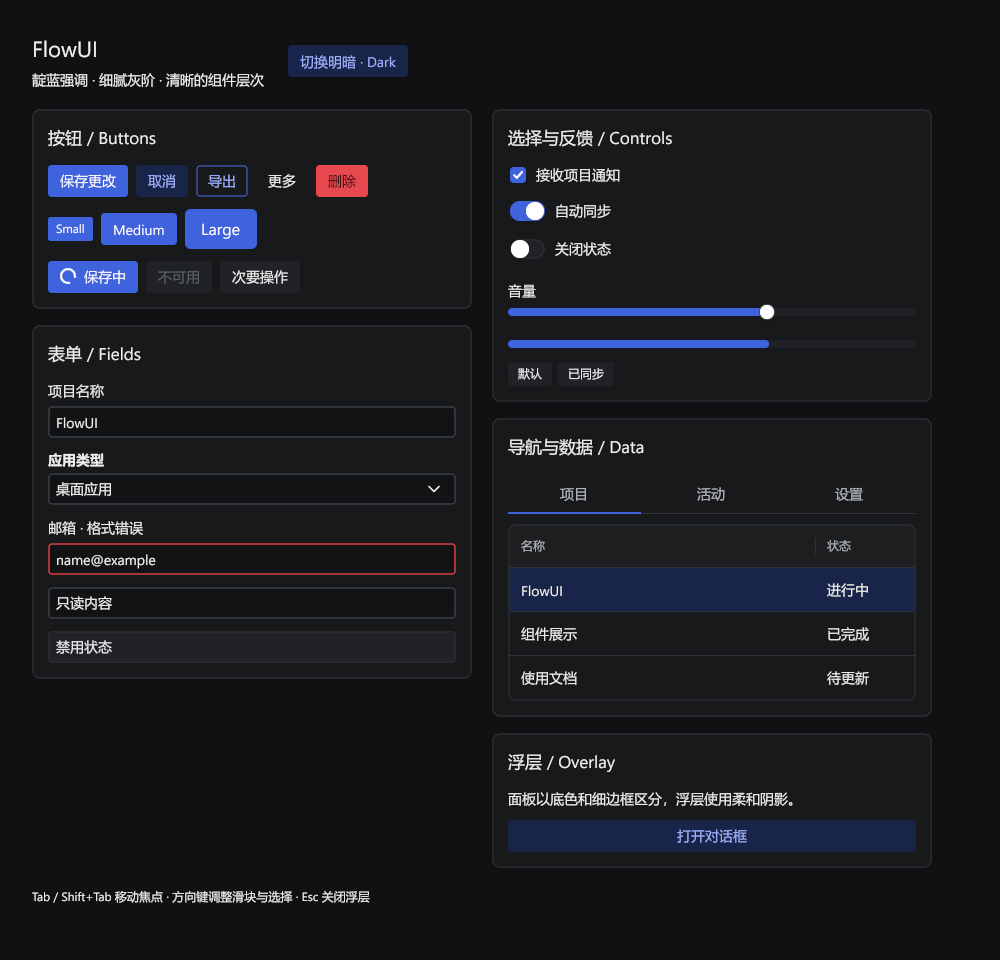

# 18 · 默认主题与外部风格

FlowUI 核心只维护 `theme/base` 一套默认设计，支持明暗两种模式。
组件的行为和布局由 `widget/` 维护，通用视觉配方由 `theme/*style` 维护。
其他设计风格由独立模块提供，应用按需引入。

## 默认主题

```go
import "github.com/qianniancn/flowui/theme/base"
```

启动窗口时显式选择主题：

```go
ui.Run(ui.NewProgram(Model{}, Update, View),
    window.Theme(base.Light()), // 深色模式用 base.Dark()
    window.Title("FlowUI"),
    window.Size(900, 640),
)
```

`base.Light()` 和 `base.Dark()` 都已安装完整 Provider，可以直接交给窗口。
`theme.New` / `theme.NewDark` 只创建主题值，适合底层扩展，不能独自作为窗口主题。
运行时在应用的消息处理路径中调用 `application.SetTheme("main", base.Dark())`，
由目标窗口的事件循环应用替换。默认明暗切换演示：

```sh
go run ./examples/style-gallery
```

## 默认视觉规范

默认主题采用 Indigo 强调色、Slate 灰阶、细边框和柔色选中态，
用表面层次区分区域。普通按钮、输入框和卡片不使用投影；菜单、弹窗等浮层保留柔和阴影。
调色板使用实色表面，不依赖 React 或 CSS。

| 角色 | 浅色 | 深色 |
| --- | --- | --- |
| 窗口背景 | `#FCFCFD` | `#111113` |
| 卡片 / 浮层 | `#FFFFFF` | `#18191B` |
| 字段背景 | `#FFFFFF` | `#121314` |
| 正文 | `#1C2024` | `#EDEEF0` |
| 强调色 | `#3E63DD` | `#3E63DD` |
| 字段边框 | `#CDCED6` | `#43484E` |

按钮和输入框的小号 / 常规 / 大号高 **24 / 32 / 40dp**，边框 **1dp**。
按钮圆角为 **3 / 4 / 6dp**，卡片为 **8dp**，对话框为 **12dp**。
正文字号为 **14sp**，展示页标题为 **17 / 22sp**。常规开关为 **35×20dp**，
白色手柄为 **18dp**；滑块使用 **8dp** 轨道和 **16dp** 白色圆形手柄。
表格常规行高 **44dp**，下划线标签页高 **40dp**。列表和表格选中项使用柔和的强调色背景。
带边框字段在悬停时加深描边；聚焦时保持底色并叠加柔和的强调色光晕，不再加粗边框。
Select / ComboBox 的选项面板与 DatePicker 日历使用 **1dp** 边框和菜单级分层阴影，与表单表面形成明确的浮层关系。

Windows 默认按 `Segoe UI, Microsoft YaHei UI, sans-serif` 选择界面字体，
为中英文提供匹配的行高，避免通用字体回退导致控件中的文字明显偏上。




浮层效果：[浅色对话框](../assets/default-theme-light-dialog.png)、
[深色对话框](../assets/default-theme-dark-dialog.png)。图片来自 Windows 上真实渲染的展示页，
可在仓库根目录用 PowerShell 重新生成：

```powershell
$env:FLOWUI_UPDATE_SCREENSHOTS = '1'
go test ./examples/style-gallery -run TestView -count=1
Remove-Item Env:FLOWUI_UPDATE_SCREENSHOTS
```

## 自定义颜色与尺寸

改主色时从种子构造主题，让颜色、状态色与语义角色一起派生：

```go
seed := theme.DefaultSeed()
seed.Primary = color.NRGBA{R: 0x10, G: 0xb9, B: 0x81, A: 0xff}
active := base.New(seed) // 深色使用 base.NewDark(seed)
active.Components.Input.Radius = 8
```

`theme`、`base` 分别导入 `github.com/qianniancn/flowui/theme` 和
`github.com/qianniancn/flowui/theme/base`，`color` 来自标准库 `image/color`。
把 `active` 传给 `window.Theme(active)`。尺寸、圆角和字体等局部设置也可以通过
选定主题之后的 `window.CustomizeTheme` 调整。已派生主题的 `Palette` 是语义颜色的
投影，直接改 `Palette.Accent` 不会重新派生主题；请改种子或调用 `UseSemantic`。

`base.Light()` / `base.Dark()` 使用默认靛蓝及红、绿、琥珀反馈色。
`base.New(seed)` / `base.NewDark(seed)` 保留传入的品牌色，并套用相同的表面、尺寸和状态规则；
填充文字会根据底色选择黑色或白色；少数状态色会做轻微调整，以保持文字对比度。
底层 `theme.DefaultSeed()` 仍是中性种子，
因此 `base.New(theme.DefaultSeed())` 的主色与 `base.Light()` 不同。

需要改变某个组件的完整视觉配方时，嵌入 `base.Provider` 并覆盖对应方法，
再设置 `active.VisualProvider`。新增组件时核心只需更新通用配方与 `base.Provider`；
外部主题可以继承它，只有需要特殊设计的组件才添加覆盖。

## 扩展契约与验收

外部主题只依赖公开的 `theme`、`theme/base`、`theme/*style` 和 `appearance` API，
无需访问 `internal/` 或复制组件。外部 Provider 可提供声明和主题专属渲染策略，
组件的交互逻辑仍属于 `widget/`。

每个主题的明暗模式都应调用 `theme/themetest.Check(t, active)`。
核心负责默认主题与视觉协议的测试；外部模块负责自身主题的验收及外观回归。
协议新增方法时更新 Provider 和验收用例；修改已有视觉契约时按版本管理兼容性。
