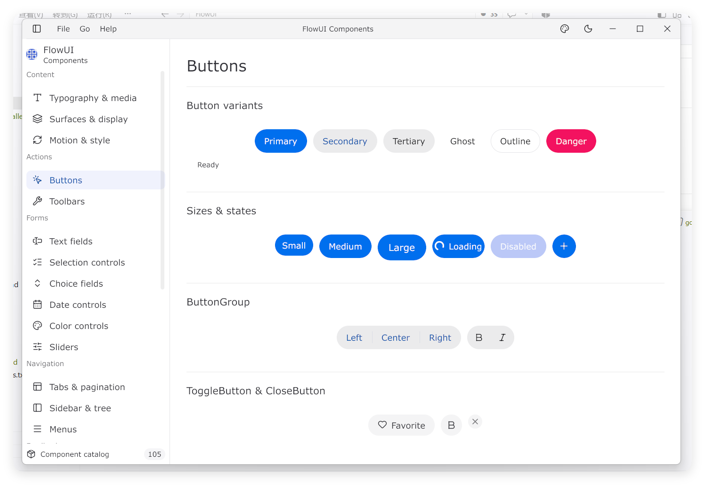

# FlowUI 文档

FlowUI 是一个基于 Gio 构建的 Go 桌面 UI 框架和组件库。本教程面向应用开发者，从第一个窗口逐步介绍状态管理、布局、样式、组件和桌面应用能力。

[English documentation](https://qianniancn.github.io/flowui/en/)

[快速开始](guide/01-快速开始.md){ .md-button .md-button--primary }
[查看源码](https://github.com/qianniancn/flowui){ .md-button }

## 阅读路径

| 顺序 | 页面 | 内容 |
|------|------|------|
| 1 | [快速开始](guide/01-快速开始.md) | 安装、第一个窗口、运行 |
| 2 | [核心概念](guide/02-核心概念.md) | 三句话、职责边界、术语 |
| 3 | [MVU 与消息](guide/03-MVU与消息.md) | Model / Msg / Update / View、封闭消息集 |
| 4 | [布局](guide/04-布局.md) | Box、Row、Column、Scroll、约束 |
| 5 | [样式与主题](guide/05-样式与主题.md) | Style、When、Part、Theme、Token |
| 6 | [组件一览](guide/06-组件一览.md) | 控件分类与常用写法 |
| 7 | [表单与受控状态](guide/07-表单与受控状态.md) | Input、Select、Open 契约 |
| 8 | [命令与订阅](guide/08-命令与订阅.md) | Cmd、Batch、LatestCmd、Subscription |
| 9 | [浮层与弹出](guide/09-浮层与弹出.md) | Modal、Popover、Menu、Toast、Portal |
| 10 | [自定义组件](guide/10-自定义组件.md) | 路径 A / B / C |
| 11 | [多窗口](guide/11-多窗口.md) | Application、Open、主题切换 |
| 12 | [动画](guide/12-动画.md) | Transition、Tween、Spring、Timeline |
| 13 | [测试](guide/13-测试.md) | uitest Harness / AppHarness |
| 14 | [常见问题](guide/14-常见问题.md) | FAQ 与排错 |
| 15 | [甘特图](guide/15-甘特图.md) | 任务排程、依赖、层级与编辑 |
| 16 | [组件截图](guide/16-组件截图.md) | 组件的视觉参考 |
| 17 | [节点图](guide/17-节点图.md) | 节点、端口、连线与受控视口 |

## 架构设计

| 文档 | 用途 |
|------|------|
| [架构说明](architecture.md) | 当前运行时、依赖方向、样式级联与交互内核 |

## 仓库对照

| 用途 | 位置 |
|------|------|
| MVU 与运行时 | `github.com/qianniancn/flowui/ui` |
| 官方组件 | `github.com/qianniancn/flowui/widget/<component>` |
| 布局 | `github.com/qianniancn/flowui/layout` |
| 样式声明 | `github.com/qianniancn/flowui/style` |
| 默认主题 | `github.com/qianniancn/flowui/theme/base`，使用 `base.Light()` / `base.Dark()` |
| 主题协议与扩展 | `github.com/qianniancn/flowui/theme`；其他风格由外部模块提供，见[迁移指南](guide/18-设计风格.md) |
| 底层绘制 | `github.com/qianniancn/flowui/draw` |
| 动画原语 | `github.com/qianniancn/flowui/animation` |
| 窗口配置 | `github.com/qianniancn/flowui/window` |
| 确定性测试 | `github.com/qianniancn/flowui/uitest` |
| 架构说明 | [FlowUI Architecture](architecture.md) |

教程只讲**应用如何组合** `ui`、`widget/<component>`、`layout`、`style`、`draw` 和
`window`；不要求阅读 `internal/`。可运行示例位于仓库的 `examples/`，与框架共用根目录的
`go.mod`，在仓库根目录运行，例如 `go run ./examples/buttons`。

## 版本说明

最低 Go 版本和当前 Gio 依赖以根目录 `go.mod` 为准；单窗口入口为 `Run(Program)`，
高级生命周期使用 `Application`。如果本地代码与教程不一致，以 `go.mod`、
`go doc github.com/qianniancn/flowui/ui` 和仓库 README 为准。
